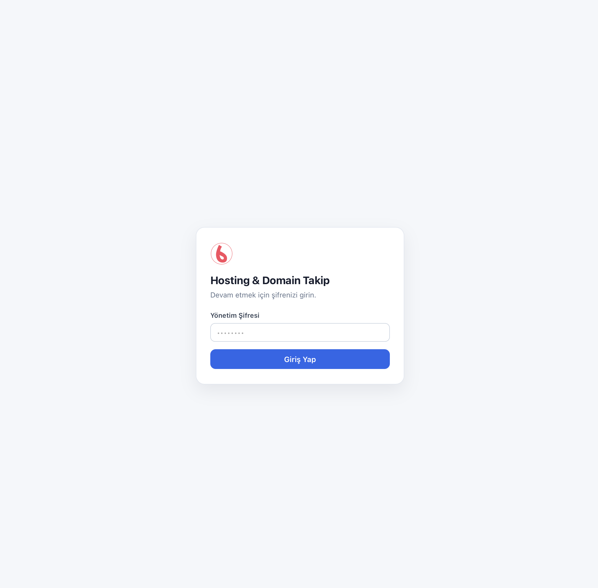
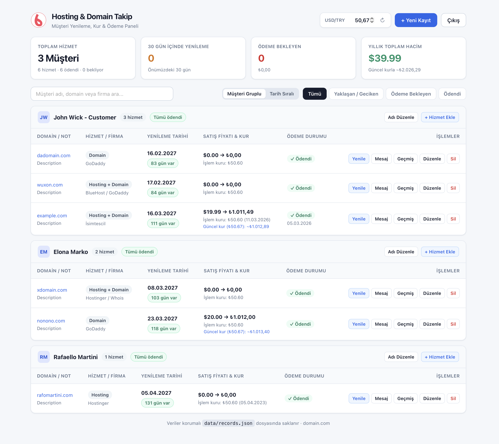

# Hosting & Domain Tracker Panel (Hosting & Domain Takip Paneli)

> 🇬🇧 English | [🇹🇷 Türkçe](#-türkçe)

A **lightweight, fast, database-free** PHP & Vanilla JS dashboard designed for freelance web developers, agencies, and anyone managing domains and hosting services for multiple clients.
## Screenshots

| Login Screen | Dashboard |
| --- | --- |
|  |  |

## Features

- **Zero Database Required:** All records are stored in a single `data/records.json` file — easy to back up and migrate in seconds.
- **Client-Grouped & Date-Sorted Views:** Groups all domains and hosting packages under each client card, with a one-click toggle to a flat date-sorted table.
- **Automatic Renewal Alerts:** Highlights upcoming renewals (within 30 days) and overdue services right at the top.
- **Two-Way Currency & Rate History:**
  - Fetches live **USD/TRY** exchange rates (rounded to 2 decimal places).
  - Supports instant two-way conversion (**USD → TRY** and **TRY → USD**).
  - Archives the previous period's exchange rate and price into the **History** log on every renewal.
- **One-Click WhatsApp Reminder:** Copies a ready-to-send renewal message with the estimated local currency total.
- **Password-Protected Login:** Session-based authentication with `.htaccess` rules blocking direct browser access to `config.php` and `data/records.json`.

## Setup (PHP / cPanel / Local)

1. Upload all files in this repository to your server directory or subdomain root (`public_html` / `app/public`).
2. Open `config.php` and change `PANEL_PASSWORD` and `API_TOKEN` to your own secure values.
3. Ensure the `data/` folder has write permissions (`755`).
4. Open your site URL in the browser and sign in with your password.

## Tech Stack

- **Backend:** PHP (Session + JSON file storage)
- **Frontend:** Pure HTML5, CSS3, and Vanilla JavaScript (no external dependencies)

## License

Released under the **MIT License**. Free to use, modify, and distribute.

---

# Türkçe

Freelance web geliştiriciler, ajanslar ve birden fazla müşteri adına domain/hosting yönetenler için hazırlanmış **hafif, hızlı ve veritabanı gerektirmeyen** takip paneli.

## Özellikler

- **Veritabanı Gerektirmez:** Tüm kayıtlar tek bir `data/records.json` dosyasında tutulur; yedeklemek ve taşımak saniyeler sürer.
- **Müşteri Gruplu & Tarih Sıralı Görünüm:** Aynı müşteriye ait tüm domain ve hosting hizmetleri tek başlık altında gruplanır; istenirse tek tıkla tarih sıralı görünüme geçilir.
- **Otomatik Yenileme Uyarıları:** 30 gün içinde yenilenecek veya süresi geçmiş hizmetler en üstte renkli olarak uyarılır.
- **Çift Yönlü Kur & Fiyat Geçmişi:**
  - Canlı **USD/TRY** kurunu çeker (2 ondalık hane).
  - Hem **USD → TL** hem **TL → USD** yönünde anlık hesaplama yapar.
  - Dönem yenilendiğinde önceki yılın dolar kuru ve satış tutarı bozulmadan **Geçmiş** arşivine kaydedilir.
- **Tek Tıkla WhatsApp Hatırlatma Metni:** Müşteriye gönderilecek yenileme mesajını güncel kur tahminiyle birlikte panoya kopyalar.
- **Şifreli Yönetim Girişi:** Oturum kontrollü giriş ekranı ve `.htaccess` ile `config.php` / `data/records.json` dosyalarına doğrudan tarayıcı erişimi engellenmiştir.

## Kurulum (PHP / cPanel / Local)

1. Bu depodaki dosyaları sunucunuzdaki bir klasöre veya subdomain kök dizinine (`public_html` / `app/public`) yükleyin.
2. `config.php` dosyasını açıp `PANEL_PASSWORD` ve `API_TOKEN` değerlerini kendi belirlediğiniz güvenli değerlerle değiştirin.
3. `data/` klasörünün yazma iznine (`755`) sahip olduğundan emin olun.
4. Tarayıcıdan site adresinizi açıp belirlediğiniz şifreyle giriş yapın.

## Teknolojiler

- **Backend:** PHP (Session + JSON dosya depolama)
- **Frontend:** Saf HTML5, CSS3 ve Vanilla JavaScript (harici kütüphane bağımlılığı yok)

## Lisans

Bu proje **MIT Lisansı** ile açık kaynak olarak paylaşılmıştır. Dilediğiniz gibi kullanabilir, uyarlayabilir ve geliştirebilirsiniz. [Barış UÇAR](https://www.barisucar.com)
